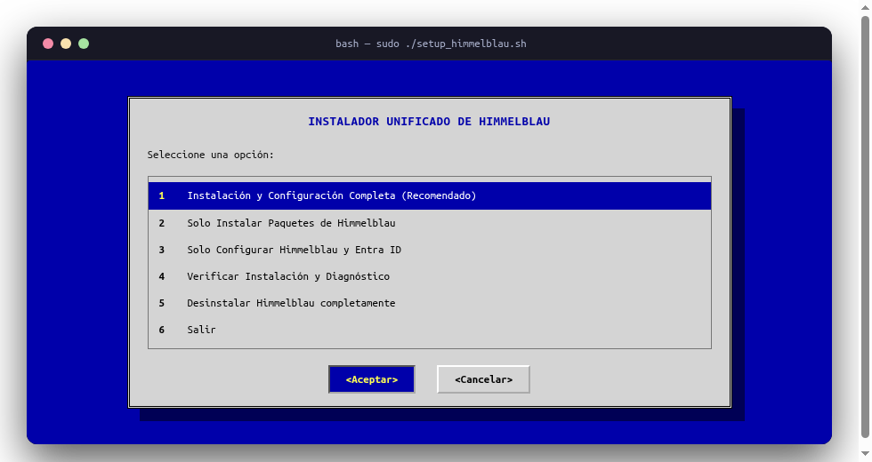
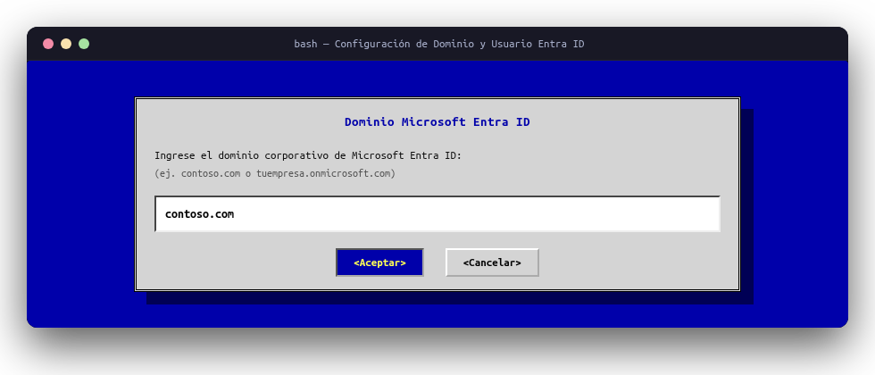
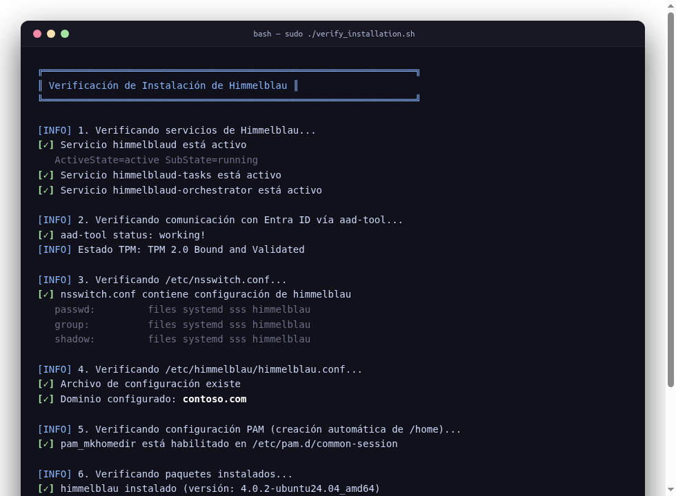

# 🌌 Microsoft Entra ID (Azure AD) Integration for Ubuntu with Himmelblau

[](https://ubuntu.com/)
[](https://himmelblau-idm.org/)
[](https://opensource.org/licenses/MIT)

Interactive, enterprise-ready automation suite to join and integrate Ubuntu Linux workstations into **Microsoft Entra ID (Azure AD)** and Intune MDM using **[Himmelblau IDM](https://himmelblau-idm.org/)** (v4.0.2+).

---

## 📦 Scripts in this Repository

| Script | Purpose |
| :--- | :--- |
| [`setup_himmelblau.sh`](setup_himmelblau.sh) | All-in-one orchestrator: dependencies, package download, system configuration, PAM/NSS, Hello PIN, and safe uninstaller. |
| [`verify_installation.sh`](verify_installation.sh) | Standalone diagnostic and health-check tool to audit daemons, PAM, NSSwitch, Entra ID connectivity, and TPM status. |

---

## ✨ Features

- 🖥️ **Interactive TUI**: Intuitive dialog menus using `whiptail` / `ncurses` (navigate with arrow keys and Enter) with clean fallback to CLI.
- ⚡ **Zero-Touch Automation**: Run unattended deployments with `--auto` flag (ideal for Microsoft Intune scripts, Ansible, Cloud-init, MDM).
- 🔑 **Modern Authentication**:
  - Direct login at GDM / LightDM login screen with Entra ID corporate credentials.
  - **Windows Hello for Linux**: TPM 2.0 + PIN fast login (`enable_hello = true`).
  - Single Sign-On (SSO) and OIDC integration.
- 🛡️ **Resilient Configuration**:
  - Automatically resolves known **Himmelblau v4 systemd `status=243/CREDENTIALS`** conflicts.
  - Prevents **MFA loops (`AADSTS500121 DUPLICATE REQUEST`)** using device-code / QR authentication.
  - Fixes **Ubuntu 24.04+ `pam_lastlog.so`** deprecation warnings.
- 📁 **PAM & NSS Integration**:
  - Automatic `/home/<user>` creation on first login via `pam_mkhomedir`.
  - Seamless name resolution via `/etc/nsswitch.conf`.
  - Dual sudoers configuration: grants administrative privileges to both full UPN and POSIX short username.
- 🚀 **Developer Ready**:
  - Automated SSH RSA 4096 key pair provisioning and `~/.ssh/config` optimized for **Azure DevOps** (`ssh.dev.azure.com`).
  - Microsoft 365 desktop launcher shortcuts (`o365`).
- 🗑️ **Safe Uninstaller**: Complete rollback mechanism with automated backups of `/etc/nsswitch.conf`.

---

## 🚀 Quick Start

### 1. Clone or Download the Repository
```bash
git clone https://github.com/blakpat/Linux.git
cd Linux/entra-id-himmelblau
chmod +x setup_himmelblau.sh verify_installation.sh
```

### 2. Run Interactively (TUI Menu)
```bash
sudo ./setup_himmelblau.sh
```

<p align="center">
  
</p>

Follow the on-screen prompts:
1. Select your target action (Option `1` for full installation).
2. Enter your Entra ID domain (e.g. `yourcompany.com` or `yourtenant.onmicrosoft.com`).

<p align="center">
  
</p>

3. Enter your corporate UPN (e.g. `user@yourcompany.com`).
4. Choose whether to grant `sudo` administrative privileges.

---

## 🤖 Unattended / Automated Deployment (`--auto`)

You can pass environment variables for non-interactive installations (ideal for Microsoft Intune Win32/Shell scripts, Cloud-init, or CI/CD pipelines):

```bash
sudo DOMAIN="yourcompany.com" ENTRA_USER="admin@yourcompany.com" ./setup_himmelblau.sh --auto
```

Available environment variables:
- `DOMAIN`: Target Microsoft Entra ID tenant domain (e.g. `contoso.com`).
- `ENTRA_USER`: User Principal Name (UPN) to pre-configure and authorize.
- `HIMMELBLAU_VERSION`: Specify Himmelblau version (defaults to `4.0.2`).

---

## 📋 Compatibility

| OS Version | Installation Mode | Himmelblau Version |
| :--- | :--- | :--- |
| **Ubuntu 22.04 LTS (Jammy)** | Standalone official .deb packages | 4.0.2 (Stable) |
| **Ubuntu 24.04 LTS (Noble)** | Standalone official .deb packages | 4.0.2 (Stable) |
| **Ubuntu 25.10 (Plucky)** | Official Nightly APT Repository | Latest / 4.x |

---

## 🔍 Verification & Health Check

Run the standalone verification script at any time to audit system health:

```bash
sudo ./verify_installation.sh
```

<p align="center">
  
</p>

The tool will inspect:
1. Systemd services (`himmelblaud`, `himmelblaud-tasks`, `himmelblaud-orchestrator`).
2. Absence of lingering legacy unit overrides in `/etc/systemd/system/`.
3. Entra ID connectivity status (`aad-tool status`).
4. Hardware TPM binding state (`aad-tool tpm`).
5. `/etc/nsswitch.conf` NSS modules.
6. Configuration syntax in `/etc/himmelblau/himmelblau.conf`.
7. Automatic home directory creation (`pam_mkhomedir.so`).
8. Interactive test of Entra ID user resolution (`getent passwd`).

---

## 🛠️ Troubleshooting & Battle-Tested Solutions

### 1. Error `status=243/CREDENTIALS` on `himmelblaud.service`
- **Symptom**: `himmelblaud` fails to start with `Failed to set up credentials: Protocol error`, or GDM login hangs with a PAM error after a long timeout.
- **Root Cause**: Residual service units in `/etc/systemd/system/himmelblaud*.service` (often left behind from older v2.x installations) referencing `hsm-pin.enc` instead of the v4 standard `hsm-pin-nopcr.enc`.
- **Solution**:
  ```bash
  sudo rm -f /etc/systemd/system/himmelblaud*.service
  sudo systemctl daemon-reload
  sudo systemctl restart himmelblaud himmelblaud-tasks
  ```
  *(Note: `setup_himmelblau.sh` performs this cleanup automatically).*

### 2. Error `AADSTS500121 DUPLICATE REQUEST` & `PAM_SYSTEM_ERR` during MFA
- **Symptom**: The user enters their password; MFA prompts on screen, but entering the number throws `PAM_SYSTEM_ERR` and the log shows `ERROR MFA poll already in progress`.
- **Root Cause**: The experimental interactive flow (`enable_experimental_mfa = true`) clashes with GDM's poll cycle and mobile push notifications.
- **Solution**: Set `enable_experimental_mfa = false` in `/etc/himmelblau/himmelblau.conf`. Himmelblau will present a QR code and device URL (`microsoft.com/devicelogin`), allowing the user to approve MFA seamlessly from their mobile phone.

### 3. Missing `/home/` Directory on First Login
- **Symptom**: Session fails to open or logs in to an empty root shell (`HOME=/`).
- **Solution**:
  ```bash
  sudo DEBIAN_FRONTEND=noninteractive pam-auth-update --package --enable mkhomedir
  ```

### 4. Windows Hello for Linux: PIN Management & Recovery
Once Windows Hello is active (`enable_hello = true`):
- **Change PIN voluntarily**: Run `passwd` in a terminal; `pam_himmelblau` will intercept the request and prompt for verification followed by the new 6+ digit PIN.
- **Forgotten PIN**: Enter an incorrect PIN 3 consecutive times at the GDM lock screen (`hello_pin_retry_count = 3`). Himmelblau will invalidate the cached PIN and prompt for a fresh Entra ID MFA re-authentication, allowing immediate PIN registration.
- **Admin PIN Reset**:
  ```bash
  sudo aad-tool cache-clear
  sudo aad-tool auth-test --name user@yourcompany.com --force-reauth
  ```

### 5. GDM Login Username Format
In the display manager (GDM / LightDM), always enter the **full UPN with domain**:
```text
user@yourcompany.com
```

---

## 🗑️ Safe Uninstallation

To cleanly remove Himmelblau and revert all changes:
```bash
sudo ./setup_himmelblau.sh
```
Select **Option 5: Desinstalar Himmelblau completamente**.

The uninstaller will:
1. Stop all services.
2. Safely purge all related Debian packages.
3. Restore `/etc/nsswitch.conf` from your pre-installation backup.
4. Back up `/etc/himmelblau` to `/root/` before cleaning up.

---

## 📄 License
This project is open source and available under the [MIT License](LICENSE).
