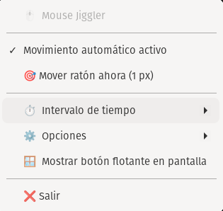

# 🖱️ Mouse Jiggler for Linux (Pop!_OS / Ubuntu)

[](https://github.com)
[](https://python.org)
[](LICENSE)
[](https://gnome.org)

**Mouse Jiggler** is a lightweight, native utility for Pop!_OS, Ubuntu, and Linux distributions. It adds an interactive button and status indicator directly to your system tray / panel (AppIndicator) that periodically executes subtle mouse movements.

It prevents your screen from locking, stops power-saving idle timers, and keeps communication tools like **Microsoft Teams, Slack, Discord, and Zoom** from automatically switching to *"Away"* or *"Inactive"*.

---

## 📸 Preview

<p align="center">
  
</p>

*Interactive tray menu on Pop!_OS / Ubuntu with toggle switch, instant 1px move, configurable intervals, smart options, and floating button.*

---

## ✨ Features

- 🎯 **Seamless Micro-Movements**: Moves the cursor by 1 pixel and immediately restores it to its original position (`+1px`, `-1px`). It resets the idle timer without disrupting your workflow or displacing the pointer.
- 🟢 **Tray Panel Indicator**: Visual indicator displaying live status (`🟢 ON` / `⚪ OFF`) located in your top or bottom panel next to network, volume, and battery icons.
- 🧠 **Smart Idle Detection**: Only moves the cursor when you are inactive. If you are actively moving the mouse or typing, it will not interrupt you.
- ⏱️ **Configurable Intervals**: Choose your preferred movement frequency (10s, 30s, 1 min, 2 min, 5 min) straight from the tray menu.
- 🪟 **Floating Widget (Optional)**: Prefer an on-screen button? Toggle a sleek, draggable, always-on-top pill button on your desktop.
- 🚀 **Autostart on Boot**: Automatically launches upon login via standard XDG autostart.
- ⌨️ **CLI & Keyboard Shortcut Support**: Control the state from the terminal or bind it to global desktop shortcuts (e.g. `Super + J`).

---

## 🚀 Quick Installation

Clone the repository and run the automated installer:

```bash
git clone https://github.com/blakpat/Linux.git
cd Linux/mouse-jiggler
./install.sh
```

*(Or clone the dedicated `mouse-jiggler` repository if hosted separately)*

The installer automatically:
1. Installs all required APT dependencies (`python3-gi`, `xdotool`, `gir1.2-ayatanaappindicator3-0.1`).
2. Deploys the executable to `~/.local/bin/mouse-jiggler`.
3. Installs clean vector SVG icons in your system theme directory.
4. Generates the `.desktop` launcher and configures auto-start upon login.
5. Launches the indicator immediately.

---

## 🖥️ Usage

### 1. From the Graphical Interface
- Click the **Mouse icon** on your panel / taskbar.
- Click **"Movimiento automático activo"** (Automatic movement) to toggle between active and paused.
- Click **"🎯 Mover ratón ahora (1 px)"** (Move 1px now) to trigger a manual movement instantly.
- Toggle **"🪟 Mostrar botón flotante en pantalla"** if you want an on-screen floating button.

### 2. From the Terminal (CLI)

```bash
# Toggle state ON / OFF
mouse-jiggler --toggle

# Move 1 pixel immediately
mouse-jiggler --move-now

# Check current status
mouse-jiggler --status

# Stop the running application
mouse-jiggler --stop
```

### 3. Binding a Global Keyboard Shortcut (Pop!_OS / Ubuntu)
1. Open **Settings** ➔ **Keyboard** ➔ **View and Customize Shortcuts** ➔ **Custom Shortcuts**.
2. Click **Add Shortcut (+)**:
   - **Name**: `Mouse Jiggler (Toggle)`
   - **Command**: `mouse-jiggler --toggle`
   - **Shortcut**: E.g. `Super + J` or `Super + Shift + M`.

---

## 📋 Compatibility

| Operating System | Support | Notes |
|---|---|---|
| **Pop!_OS (20.04 / 22.04 / COSMIC)** | ✅ 100% Native | Runs on X11 session by default. |
| **Ubuntu 20.04 / 22.04 / 24.04** | ✅ Compatible | Recommended session: **Ubuntu on Xorg** (X11). |
| **Linux Mint / Debian** | ✅ Compatible | Requires desktop environment with AppIndicator / Tray support. |

> **Note regarding Wayland**: On distributions running Wayland by default, security policies restrict `xdotool` from globally generating synthetic mouse events outside Xwayland windows. On your login / password screen, click the **gear icon ⚙️** (bottom right corner) and select **"Ubuntu on Xorg"** for complete compatibility.

---

## 🗑️ Uninstallation

To cleanly remove the application and all associated configuration files:

```bash
cd mouse-jiggler
./uninstall.sh
```

---

## 📄 License

This project is licensed under the [MIT License](LICENSE).
